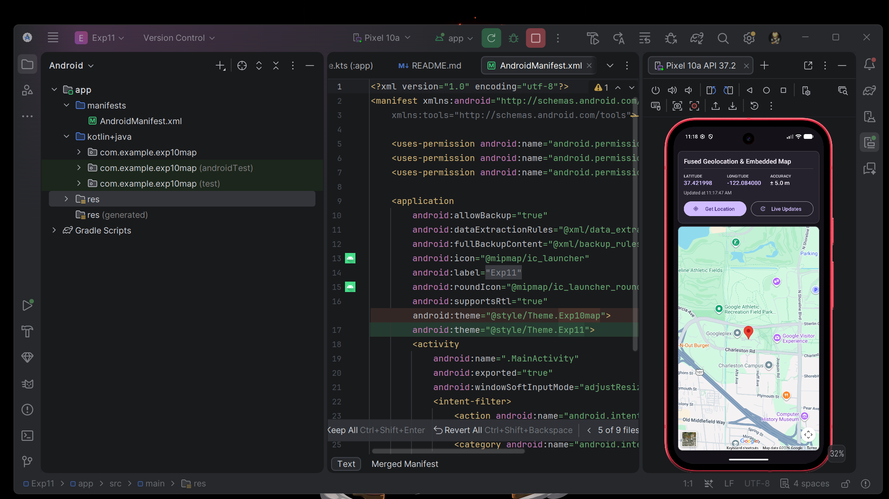

# Credential Vault — Android Key-Value SQLite Persistence App

A clean, modern, and secure Android application demonstrating **SQLite Key-Value Pair Data Persistence**, instant real-time auto-saving as the user types, automatic credential restoration ("auto-paste"), and multi-screen navigation with session management.

---

## 🌟 Key Features

1. **Instant Real-time Persistence**:
   - As the user types into the Username or Password fields on the Login screen, input is saved instantly into an embedded SQLite database in real-time before clicking Login.

2. **Auto-Fill / Auto-Paste on Launch**:
   - When the app process is closed or killed and restarted, saved credentials are automatically queried from SQLite and auto-populated into the login fields.

3. **Key-Value Pair SQLite Persistor**:
   - Built using a dedicated `SQLiteOpenHelper` (`CredentialDatabaseHelper`) storing data in a key-value pair format (`key_name TEXT PRIMARY KEY, value_text TEXT`).

4. **Home Dashboard & Navigation**:
   - Successful login redirects the user to `HomeActivity` displaying a personalized welcome greeting.

5. **Session Termination & Logout**:
   - The Home Dashboard contains a prominent **LOGOUT** button that wipes the saved credentials from the SQLite database and redirects back to the Login screen.

6. **Professional Material Design UI**:
   - Clean Material 3 cards, rounded input fields, password toggle visibility, and auto-fill notification badges.

---

## 📱 Screenshots & UI Architecture




---


---

## 🗄️ Database Architecture

The application utilizes an embedded **SQLite Database** named `UserCredentials.db`.

### Schema: `credentials`

| Column Name | Data Type | Constraint | Description |
| :--- | :--- | :--- | :--- |
| `key_name` | `TEXT` | `PRIMARY KEY` | Unique key identifier (e.g., `saved_username`, `saved_password`) |
| `value_text` | `TEXT` | `NULLABLE` | Persisted string value associated with the key |

* **Location on Device**:  
  `/data/data/com.example.exp9/databases/UserCredentials.db`

---

## 🛠️ Tech Stack & Project Structure

* **Language**: Kotlin 1.9 / 2.0
* **UI Toolkit**: Android Material Design 3 (`com.google.android.material`)
* **Persistence**: Native Android SQLite (`SQLiteOpenHelper`)
* **Architecture**: Android Jetpack Components (`AppCompatActivity`, `ViewCompat`, `WindowInsetsCompat`)

### File Directory Structure
```
exp9/
├── app/
│   ├── src/
│   │   └── main/
│   │       ├── java/com/example/exp9/
│   │       │   ├── MainActivity.kt               # Login UI & Instant Auto-Save logic
│   │       │   ├── HomeActivity.kt               # Home Dashboard & Logout logic
│   │       │   └── CredentialDatabaseHelper.kt   # SQLite Key-Value Data Persistor
│   │       ├── res/
│   │       │   ├── layout/
│   │       │   │   ├── activity_main.xml         # Login Screen Layout
│   │       │   │   └── activity_home.xml         # Home Dashboard Layout
│   │       │   └── values/
│   │       │       ├── colors.xml                # Color theme tokens
│   │       │       └── strings.xml               # Translatable string resources
│   │       └── AndroidManifest.xml              # App manifest & activity declarations
└── build.gradle.kts
```

---

