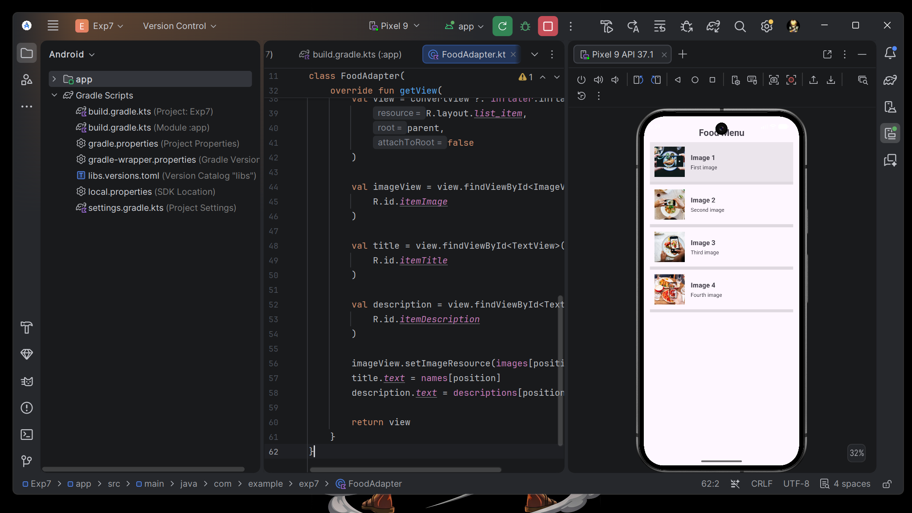

# Experiment 7 – Adaptive Android Application with ListView and ImageView

## Overview

This project demonstrates how to create an adaptive Android application using **ListView** and **ImageView**. The application displays multiple images in a scrollable list along with their corresponding titles and descriptions.

## Concept & Technology

### ListView

`ListView` is used to display a vertically scrollable list of items in the application.

### ImageView

`ImageView` is used to display images inside each ListView item.

### Adaptive Layout

The application uses `match_parent`, `wrap_content`, `dp`, `sp`, and `layout_weight` so that the list items can adjust to the available screen width.

### Components Used:

- **Kotlin:** Programming language for application logic.
- **XML Layouts:** Used to define the user interface.
- **ListView:** Displays the list of items.
- **ImageView:** Displays the images.
- **BaseAdapter:** Connects the image and text data with the ListView.

## Scenario

The application implements a simple image gallery:

1. The main screen contains a `ListView`.
2. Four images (`img1`, `img2`, `img3`, and `img4`) are stored in the `drawable` folder.
3. A custom `FoodAdapter` is used to display each image.
4. Each list item contains an `ImageView`, a title, and a description.
5. The layout adapts to the available screen width using responsive XML attributes.

## Folder and File Structure

```text
Exp7/
├── app/
│   ├── src/
│   │   ├── main/
│   │   │   ├── java/com/example/exp7/
│   │   │   │   ├── MainActivity.kt
│   │   │   │   └── FoodAdapter.kt
│   │   │   ├── res/
│   │   │   │   ├── drawable/
│   │   │   │   │   ├── img1.webp
│   │   │   │   │   ├── img2.webp
│   │   │   │   │   ├── img3.webp
│   │   │   │   │   └── img4.webp
│   │   │   │   ├── layout/
│   │   │   │   │   ├── activity_main.xml
│   │   │   │   │   └── list_item.xml
│   │   │   │   └── values/
│   │   │   │       └── strings.xml
│   │   │   └── AndroidManifest.xml
│   │   └── build.gradle.kts
│   ├── build.gradle.kts
└── settings.gradle.kts

```

## Output




## Result

The adaptive Android application was successfully created using `ListView` and `ImageView`. The application displays images and corresponding text in a scrollable list that adapts to the available screen width.

