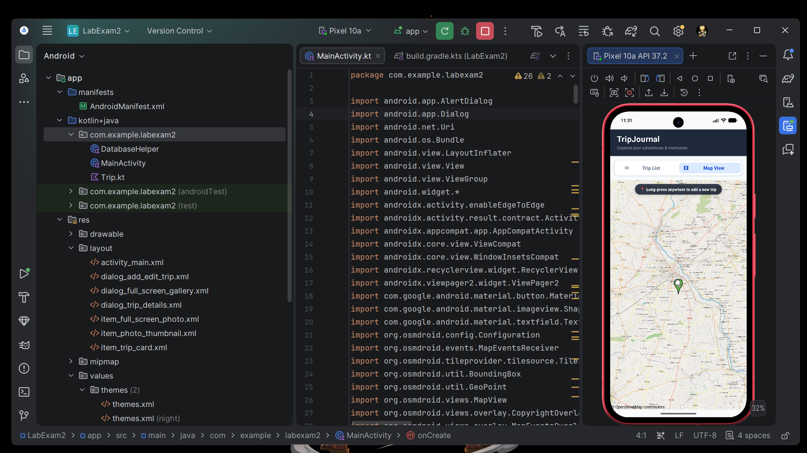
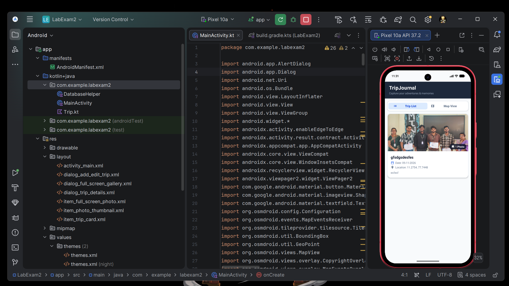
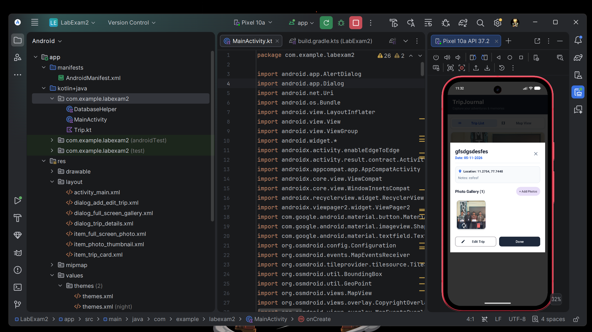

# TripJournal -- Travel Diary & Photo Gallery

## Overview

TripJournal is an Android application that allows users to record their
travel experiences by saving visited places, adding notes, and
maintaining photo galleries for each trip.

The application uses **SQLite** for local data storage and
**OpenStreetMap (OSM)** to display locations on an interactive map.
Users can add trips by long-pressing a location on the map, manage trip
details, and attach multiple photos to each trip.

The application is developed using Kotlin and XML layouts.

## Concept & Technology

### OpenStreetMap Integration

OpenStreetMap provides map data to display geographical locations within
the application. The application uses the **osmdroid** library to
integrate an interactive map without requiring a Google Maps API key.

### SQLite Database

SQLite is used to store trip information locally, including trip title,
date, notes, latitude, and longitude. A separate table stores the photos
associated with each trip.

### Trip Management

Users can add, view, edit, and delete trips. Each trip contains
information about the visited location and its corresponding travel
details.

### Photo Gallery

Users can select multiple photos from their device and associate them
with a trip. Existing photos can also be replaced or deleted.

### Components Used

-   **Kotlin:** Programming language used for application logic.
-   **XML Layouts:** Define the application's user interface.
-   **SQLite:** Stores trip details and photo information.
-   **OpenStreetMap:** Provides geographical map data.
-   **osmdroid:** Integrates OpenStreetMap into the Android application.
-   **MapView:** Displays the interactive map.
-   **Activity Result APIs:** Used to select images from the device.
-   **Dynamic Views:** Used to display trip information and photos.

## Scenario

The application demonstrates the development of a travel diary with map
integration:

1.  The application initializes the local SQLite database.
2.  The user can switch between the trip list and map views.
3.  The map displays the geographical locations of saved trips using
    markers.
4.  The user long-presses a location on the map to add a new trip.
5.  The user enters the trip title, notes, and date.
6.  The trip details and geographical coordinates are saved in SQLite.
7.  Users can attach multiple photos from the device to a trip.
8.  Selecting a trip displays its details and associated photo gallery.
9.  Users can edit or delete trips and manage their associated photos.
10. The updated information is reflected in the trip list and map.

## Folder and File Structure

``` text
TripJournal/
├── app/
│   └── src/
│       └── main/
│           ├── java/
│           │   └── com/example/labexam2/
│           │       ├── MainActivity.kt
│           │       ├── DatabaseHelper.kt
│           │       └── Trip.kt
│           ├── res/
│           │   └── layout/
│           │       └── activity_main.xml
│           └── AndroidManifest.xml
├── build.gradle.kts
└── settings.gradle.kts
```

*Note: This is an illustrative folder structure. Additional layout files
and classes may be present in the project.*

## Permissions

The application requires the following permissions in
`AndroidManifest.xml`:

``` xml
<uses-permission android:name="android.permission.INTERNET" />

<uses-permission android:name="android.permission.ACCESS_NETWORK_STATE" />
```

Internet permission allows the application to load OpenStreetMap tiles,
while network state permission helps access network connectivity
information.

## UI Design

The application provides a simple interface for managing travel records.

### Trip List Screen

-   Displays saved trips.
-   Shows trip titles, dates, and location details.
-   Provides options to view, edit, and delete trips.
-   Allows users to access individual trip details.

### Map Screen

-   Displays an interactive OpenStreetMap interface.
-   Allows users to explore geographical locations.
-   Supports long-pressing a location to add a new trip.
-   Displays markers for previously saved trips.
-   Allows users to open trip details by selecting a marker.

### Trip Details & Photo Gallery

-   Displays the selected trip's information.
-   Shows multiple photos associated with the trip.
-   Allows users to add, replace, and delete photos.
-   Provides options to edit or delete the trip.

## Output







## Result

The TripJournal Android application demonstrates the development of a
location-based travel diary using Kotlin, SQLite, and OpenStreetMap.

Users can record visited places, maintain travel details, manage photo
galleries, and view saved trips on an interactive map.

Thus, a travel diary application with local database management, map
integration, and photo gallery functionality was successfully developed.
