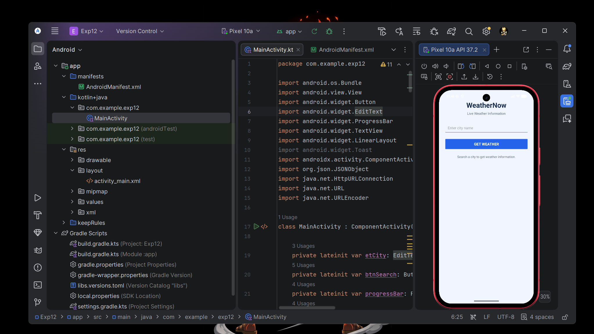
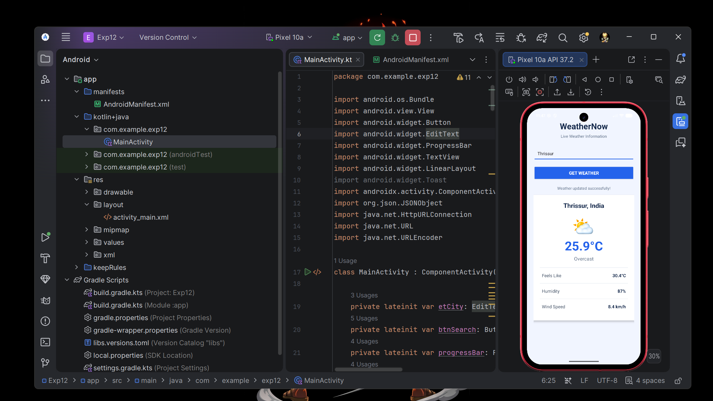

# Experiment 12 – Weather Application Using HTTP Requests

## Overview

This project demonstrates how to access online weather services from an Android application using HTTP GET requests. The application allows the user to search for a city and displays its current weather information, including temperature, weather condition, feels-like temperature, humidity, and wind speed.

The application is developed using Kotlin and XML layouts. It uses the Open-Meteo Geocoding API to retrieve a city's geographical coordinates and the Open-Meteo Weather API to obtain weather information for those coordinates.

## Concept & Technology

### HTTP GET Requests

HTTP GET is used to request information from a web server. The application sends GET requests to online APIs to retrieve the city coordinates and current weather data. The server returns the requested information in JSON format.

### Geocoding API

The Open-Meteo Geocoding API converts the city name entered by the user into geographical coordinates (latitude and longitude). These coordinates are then used to request weather information.

### Weather API

The Open-Meteo Weather API provides current weather information for the supplied latitude and longitude. The application requests temperature, relative humidity, apparent temperature, weather code, and wind speed.

### JSON Parsing

The API responses are received in JSON format. The Android `JSONObject` class is used to extract the required values from the responses and prepare them for display.

### Background Threading

Network operations are performed on a background thread so that the main UI thread remains responsive while the application communicates with the APIs.

### Components Used

- **Kotlin:** Programming language used for application logic.
- **XML Layouts:** Define the application's user interface.
- **MainActivity:** Handles user interaction, API requests, and updates to the interface.
- **HttpURLConnection:** Establishes HTTP connections and sends GET requests.
- **JSONObject:** Parses the JSON responses received from the APIs.
- **Thread:** Executes network operations in the background.
- **Open-Meteo Geocoding API:** Converts a city name into latitude and longitude.
- **Open-Meteo Weather API:** Provides current weather information.
- **Internet Permission:** Allows the application to access online web services.

## Scenario

The application demonstrates how an Android application retrieves and displays weather information from online web services:

1. The application displays a city input field and a Get Weather button.
2. The user enters a city name and taps the button.
3. The application checks that the city field is not empty.
4. A background thread sends an HTTP GET request to the Open-Meteo Geocoding API.
5. The API returns the matching city's latitude and longitude.
6. The application sends a second HTTP GET request to the Open-Meteo Weather API using those coordinates.
7. The weather API returns current weather information in JSON format.
8. The application parses the JSON response to extract temperature, apparent temperature, humidity, wind speed, and weather code.
9. The weather code is mapped to a readable weather condition and a corresponding emoji.
10. The application displays the retrieved weather information on the screen.
11. If a request fails or the city cannot be found, an error message is displayed.

## Folder and File Structure

```text
Exp12/
├── app/
│   └── src/
│       └── main/
│           ├── java/
│           │   └── com/example/exp12/
│           │       └── MainActivity.kt
│           ├── res/
│           │   └── layout/
│           │       └── activity_main.xml
│           └── AndroidManifest.xml
├── build.gradle.kts
└── settings.gradle.kts
```

*Note: This is an illustrative folder structure. The actual package name and file organization may differ in the project.*

## Permissions

The application requires the following permission in `AndroidManifest.xml`:

```xml
<uses-permission android:name="android.permission.INTERNET" />
```

Internet permission allows the application to communicate with the Open-Meteo Geocoding and Weather APIs. No runtime permission is required for this implementation because the application uses a city entered by the user rather than accessing the device's location.

## UI Design

The application uses a simple weather-focused interface.

### Main Weather Screen

- Displays the application title and a city input field.
- Provides a Get Weather button to initiate the API requests.
- Displays a loading indicator while weather information is being retrieved.
- Shows the city name and country.
- Displays the current temperature and weather condition.
- Shows feels-like temperature, humidity, and wind speed.
- Displays an error or status message when appropriate.

### Weather Information

The application displays the following information returned by the weather API:

- **Temperature:** Current air temperature in degrees Celsius.
- **Weather Condition:** A readable description derived from the weather code.
- **Feels Like:** Apparent temperature in degrees Celsius.
- **Humidity:** Relative humidity as a percentage.
- **Wind Speed:** Wind speed in kilometres per hour.

## API Endpoints

The application uses the following Open-Meteo endpoints:

- **Geocoding:** `https://geocoding-api.open-meteo.com/v1/search`
- **Current Weather:** `https://api.open-meteo.com/v1/forecast`

The Geocoding API is used first to obtain the coordinates. The Weather API is then called with those coordinates to retrieve the current weather information.

## Output





## Result

The Android application demonstrates how to access online web services using HTTP GET requests. It retrieves a city's geographical coordinates using the Open-Meteo Geocoding API, obtains current weather information using the Open-Meteo Weather API, parses the JSON responses, and displays the weather details using an XML-based user interface.

Thus, accessing web services through HTTP requests and displaying the retrieved data in an Android application was demonstrated.

